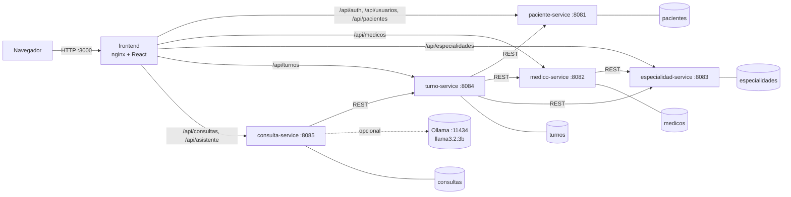
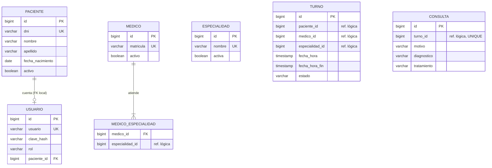
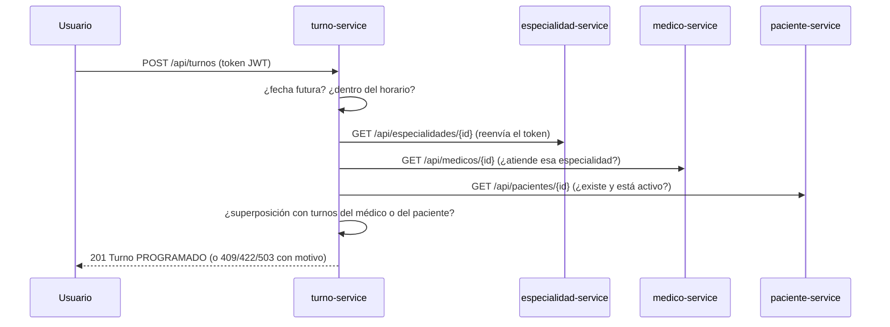

# Informe técnico — Sistema de consultas médicas basado en microservicios

**Trabajo final de Backend**

**Repositorio:** https://github.com/brunitobottone06-ui/MicroserviciosConsultamedica

**Manual de instalación y uso:** [README.md](../README.md)

---

## Índice

1. [Resumen](#1-resumen)
2. [Requisitos del trabajo y cómo se cumplen](#2-requisitos-del-trabajo-y-cómo-se-cumplen)
3. [Arquitectura](#3-arquitectura)
4. [Tecnologías y versiones](#4-tecnologías-y-versiones)
5. [Microservicios y API REST](#5-microservicios-y-api-rest)
6. [Modelo de datos](#6-modelo-de-datos)
7. [Comunicación entre servicios y resiliencia](#7-comunicación-entre-servicios-y-resiliencia)
8. [Seguridad: inicio de sesión y roles](#8-seguridad-inicio-de-sesión-y-roles)
9. [Asistente de IA](#9-asistente-de-ia)
10. [Frontend](#10-frontend)
11. [Ejecución con Docker Compose](#11-ejecución-con-docker-compose)
12. [Calidad y pruebas](#12-calidad-y-pruebas)
13. [Decisiones de diseño](#13-decisiones-de-diseño)
14. [Limitaciones y trabajo futuro](#14-limitaciones-y-trabajo-futuro)
15. [Glosario de conceptos clave](#15-glosario-de-conceptos-clave)

---

## 1. Resumen

Se desarrolló un sistema **local** para la gestión de un consultorio médico, compuesto por:

- **Cinco microservicios** Spring Boot: Paciente, Médico, Especialidad, Turno y Consulta. Cada uno tiene su
  **propia base de datos PostgreSQL**.
- Un **frontend web** en React + TypeScript, separado de los microservicios.
- Un **asistente de IA** integrado en el microservicio Consulta mediante **Spring AI** y **Ollama**. El modelo
  se ejecuta en la propia computadora y es **opcional**: si no está disponible, el resto del sistema sigue funcionando.
- **Inicio de sesión con JWT** y tres roles: administrativo, médico y paciente.
- **Docker Compose** para levantar todo el sistema con un solo comando.

---

## 2. Requisitos del trabajo y cómo se cumplen

| Requisito | Implementación |
|---|---|
| Java 25, Spring Boot 4.1.2, Maven | `<java.version>25</java.version>`, `spring-boot-starter-parent 4.1.2`, Maven Wrapper 3.9.16 |
| Spring AI compatible con Boot 4.1.2 | **Spring AI 2.0.2** mediante su BOM (`spring-ai-bom`). La documentación oficial indica: *"Spring AI 2.0.x supports Spring Boot 4.0.x and 4.1.x"* |
| Exactamente 5 microservicios, sin un 6.º para la IA | paciente, medico, especialidad, turno y consulta. El asistente está **dentro** de consulta-service |
| Una base PostgreSQL por microservicio | 5 contenedores `postgres:17-alpine`, cada uno con su volumen |
| Sin acceso a la base de otro servicio | Las relaciones entre servicios son **IDs** validados por **API REST**. No hay claves foráneas entre bases |
| Frontend React + TypeScript + Vite | Carpeta `frontend/`, servida por nginx en Docker |
| Ollama local y opcional | Perfil `ia` de Docker Compose. Sin Ollama, el sistema inicia y funciona; el frontend explica el motivo |
| El asistente no diagnostica ni accede a datos clínicos | Filtro determinista de preguntas clínicas, ocultamiento de datos personales y prueba de arquitectura (ArchUnit) |
| Health checks, timeouts, reintentos seguros | Actuator + health checks de Docker; timeouts de 2 s y 3 s; `@Retryable` solo en operaciones idempotentes |
| Sin secretos en el código | Credenciales en `.env` (excluido del repositorio); `.env.example` como plantilla |
| Pruebas unitarias y de integración | 125 pruebas de backend y 44 de frontend (ver [sección 12](#12-calidad-y-pruebas)) |

---

## 3. Arquitectura

**Puntos clave:**

- **Un solo punto de entrada.** El navegador solo habla con el frontend (puerto 3000). nginx actúa como
  **proxy inverso** y reenvía cada ruta `/api/...` al microservicio que corresponde. En desarrollo, el proxy de
  Vite cumple el mismo rol. Así no hace falta configurar CORS.
- **Dependencias en un solo sentido.** Las llamadas entre servicios no forman ciclos: Médico → Especialidad;
  Turno → Paciente, Médico, Especialidad; Consulta → Turno.
- **Organización interna.** Cada microservicio tiene la misma estructura de paquetes: `api` (controladores y
  DTOs), `dominio` (entidades JPA y repositorios), `servicio` (reglas de negocio), `cliente` (llamadas a otros
  servicios), `error` (manejo de errores) y `seguridad`.

---

## 4. Tecnologías y versiones

| Capa | Tecnología | Versión |
|---|---|---|
| Lenguaje backend | Java (Liberica / Temurin) | 25 |
| Framework | Spring Boot (Web MVC, Data JPA, Validation, Actuator, Security) | 4.1.2 |
| IA | Spring AI (starter `spring-ai-starter-model-ollama`) | 2.0.2 |
| Persistencia | Hibernate ORM / Flyway | 7.4 / 12.4 (gestionadas por Boot) |
| Base de datos | PostgreSQL (`postgres:17-alpine`) | 17 |
| Modelo de IA | Ollama (`ollama/ollama:0.40.14`) con `llama3.2:3b` | — |
| Construcción | Maven Wrapper | 3.9.16 |
| Frontend | React / TypeScript / Vite / React Router | 19.3 / 7.0 / 8.3 / 7.18 |
| Pruebas | JUnit 5, Mockito, MockMvc, H2, ArchUnit 1.5.1; Vitest 5 + Testing Library | — |
| Contenedores | Docker Compose; nginx 1.28 para servir el frontend | — |

**Por qué Spring AI 2.0.2:** según la documentación oficial, la línea 2.0.x es la compatible con Spring Boot
4.0.x y 4.1.x (la 2.1 apunta a Boot 4.2). Se eligió la última versión estable de esa línea al momento del
desarrollo y se importó mediante su BOM, como recomienda el proyecto.

---

## 5. Microservicios y API REST

Todas las respuestas son JSON. Los errores siguen el formato estándar **Problem Details (RFC 9457)**, con un
mensaje en español en el campo `detail`.

### paciente-service (8081): pacientes, usuarios e inicio de sesión

| Método | Ruta | Descripción | Acceso |
|---|---|---|---|
| POST | `/api/auth/login` | Inicia sesión y devuelve un token JWT | Público |
| POST | `/api/auth/registro` | Crea la cuenta de un paciente nuevo (su usuario es su DNI) | Público |
| GET | `/api/auth/yo` | Datos del usuario de la sesión | Con sesión |
| GET | `/api/pacientes?buscar=&incluirInactivos=` | Listado y búsqueda por nombre, apellido o DNI | Administrativo, Médico |
| GET | `/api/pacientes/{id}` | Ficha del paciente | Personal, o el propio paciente |
| POST / PUT | `/api/pacientes`, `/api/pacientes/{id}` | Alta y edición | Administrativo |
| DELETE | `/api/pacientes/{id}` | Baja lógica | Administrativo |
| PATCH | `/api/pacientes/{id}/reactivar` | Reactivar | Administrativo |
| POST | `/api/pacientes/{id}/acceso` | Habilitar el acceso web de un paciente existente | Administrativo |
| GET / POST | `/api/usuarios` | Listar y crear cuentas del personal | Administrativo |
| PATCH | `/api/usuarios/{id}/activar` / `desactivar` | Activar o desactivar una cuenta | Administrativo |

### medico-service (8082) y especialidad-service (8083)

| Método | Ruta | Descripción | Acceso |
|---|---|---|---|
| GET | `/api/medicos?especialidadId=&incluirInactivos=` | Listado (filtro por especialidad) | Con sesión |
| GET | `/api/medicos/{id}` | Detalle | Con sesión |
| POST / PUT / DELETE / PATCH `…/reactivar` | `/api/medicos…` | Alta, edición, baja lógica y reactivación. Valida las especialidades contra especialidad-service | Administrativo |
| GET | `/api/especialidades?incluirInactivas=`, `/api/especialidades/{id}` | Listado y detalle | Con sesión |
| POST / PUT / DELETE / PATCH `…/reactivar` | `/api/especialidades…` | Alta, edición, baja lógica y reactivación | Administrativo |

### turno-service (8084)

| Método | Ruta | Descripción | Acceso |
|---|---|---|---|
| GET | `/api/turnos?pacienteId=&medicoId=&especialidadId=&estado=&desde=&hasta=` | Listado con filtros. Para un paciente se fuerza su propio ID | Con sesión |
| GET | `/api/turnos/{id}` | Detalle | Personal, o el paciente dueño |
| GET | `/api/turnos/horario` | Horario de atención configurado | Con sesión |
| POST | `/api/turnos` | Reservar (valida contra los 3 servicios, el horario y la superposición) | Con sesión (un paciente solo para sí mismo) |
| PUT | `/api/turnos/{id}` | Reprogramar | Administrativo |
| PATCH | `/api/turnos/{id}/cancelar` | Cancelar (queda en estado CANCELADO) | Personal, o el paciente dueño |
| PATCH | `/api/turnos/{id}/atender` | Marcar atendido (lo invoca consulta-service) | Médico |
| DELETE | `/api/turnos/{id}` | Eliminar, solo si está cancelado | Administrativo |

Ciclo de vida de un turno: **PROGRAMADO** → CANCELADO (que luego puede eliminarse) o → **ATENDIDO** (al registrar la consulta).

### consulta-service (8085): consultas y asistente

| Método | Ruta | Descripción | Acceso |
|---|---|---|---|
| GET | `/api/consultas?pacienteId=&medicoId=&turnoId=` | Listado | Médico |
| GET / POST / PUT / DELETE | `/api/consultas…` | Detalle, registro (marca el turno como atendido), edición y eliminación | Médico |
| GET | `/api/asistente/estado` | ¿Está disponible el asistente? Si no, informa el motivo | Con sesión |
| POST | `/api/asistente/chat` | Pregunta al asistente | Con sesión |

**Health checks:** `/actuator/health/readiness` en cada servicio, público para que Docker pueda consultarlo.

---

## 6. Modelo de datos

Cada base tiene sus propias tablas, creadas con **migraciones Flyway** (archivos `V1__…sql`, `V2__…sql`).
Hibernate solo **valida** que las entidades coincidan con esas tablas (`ddl-auto: validate`).

| Base | Tablas |
|---|---|
| `pacientes` | `paciente`, `usuario` (con FK local `usuario.paciente_id → paciente.id`) |
| `medicos` | `medico`, `medico_especialidad` |
| `especialidades` | `especialidad` |
| `turnos` | `turno` (checks de estado, de duración entre 10 y 120 minutos y de fin posterior al inicio) |
| `consultas` | `consulta` (`turno_id` único: una consulta por turno) |

**Reglas importantes:**

- **Referencias lógicas:** `especialidad_id`, `paciente_id`, `medico_id` y `turno_id` apuntan a datos de **otros
  servicios**. No tienen clave foránea porque viven en otra base; su validez se comprueba por API al crear o editar.
- **Baja lógica:** pacientes, médicos y especialidades no se borran, se marcan inactivos. Así los turnos y las
  consultas históricas siguen siendo consistentes y no hacen falta dependencias circulares para verificar referencias.
- **Contraseñas:** se guardan solo como **hash BCrypt**, nunca en texto plano.
- **Datos de ejemplo:** se cargan datos ficticios con migraciones repetibles (`R__datos_de_ejemplo.sql`): 5
  especialidades, 4 médicos y 3 pacientes.

---

## 7. Comunicación entre servicios y resiliencia

### Reservar un turno

### Registrar una consulta

consulta-service obtiene el turno, guarda la consulta **dentro de su transacción** y luego llama a
`PATCH /api/turnos/{id}/atender`. Si turno-service falla, se lanza una excepción y la transacción local **se
deshace**, por lo que no queda una consulta sin turno atendido.

Como "atender" es **idempotente**, también se acepta registrar la consulta de un turno que ya figura ATENDIDO
sin consulta (por ejemplo, si un intento anterior falló justo después de avisar a Turnos).

### Mecanismos de resiliencia

| Mecanismo | Dónde | Detalle |
|---|---|---|
| **Timeouts** | Clientes REST entre servicios | Conexión 2 s, lectura 3 s (`JdkClientHttpRequestFactory`). Para Ollama: lectura 150 s |
| **Reintentos limitados** | Solo lecturas (GET) y "atender", que es idempotente | `@Retryable` nativo de Spring Framework 7: 2 reintentos con espera creciente (300 ms y 600 ms) |
| **Sin reintentos** | Creación de turnos y llamadas al modelo de IA | Para no duplicar operaciones ni dejar al usuario esperando minutos. Se desactivó el reintento propio de Spring AI (`spring.ai.retry.max-attempts: 0`), que por defecto hace 10 intentos |
| **Degradación controlada** | Todos los servicios | Si otro servicio no responde se devuelve **503** con el nombre del servicio afectado; el resto sigue funcionando |
| **Dependencias blandas** | Docker Compose | Cada servicio espera solo a **su** base de datos para iniciar |
| **Health checks** | Bases y servicios | `pg_isready` y Actuator readiness; el frontend muestra el estado de cada servicio |
| **Bloqueo optimista** | Turnos y consultas | `@Version` evita que dos ediciones simultáneas se pisen (responde 409) |

---

## 8. Seguridad: inicio de sesión y roles

- **Tokens.** paciente-service verifica la contraseña (BCrypt) y emite un **token JWT firmado con HS256**. El
  token contiene el usuario, el nombre, el rol y, si es paciente, el ID de su ficha. Vence a las 8 horas.
- **Validación independiente.** Cada uno de los 5 servicios verifica la firma con la **misma clave**
  (`JWT_SECRETO`, en `.env`) sin consultar a paciente-service. Por eso, si paciente-service se cae, los demás
  siguen validando sesiones.
- **Reenvío del token.** Cuando un servicio llama a otro, reenvía el token del mismo usuario. El servicio
  llamado aplica sus propias reglas a esa persona.
- **Propiedad de los datos.** Un paciente solo ve, pide y cancela **sus** turnos y solo ve **su** ficha, aunque
  manipule el pedido (por ejemplo, cambiando el ID).
- **Administrador inicial.** Se crea automáticamente la primera vez, con `ADMIN_USUARIO` y `ADMIN_CLAVE` del `.env`.
- **Mensaje de error genérico.** Un intento de inicio de sesión fallido responde "Usuario o contraseña
  incorrectos.", exista o no el usuario.

| Acción | Administrativo | Médico | Paciente |
|---|:-:|:-:|:-:|
| Gestionar pacientes, médicos, especialidades y usuarios | ✅ | ❌ (solo lectura) | ❌ |
| Reservar turnos | ✅ (para cualquiera) | ✅ | ✅ (solo para sí) |
| Cancelar turnos | ✅ | ✅ | ✅ (solo los propios) |
| Reprogramar o eliminar turnos | ✅ | ❌ | ❌ |
| Ver y registrar consultas (datos clínicos) | ❌ | ✅ | ❌ |
| Usar el asistente | ✅ | ✅ | ✅ |

El frontend oculta las acciones que no corresponden al rol, pero **la protección real la hace el backend**.

---

## 9. Asistente de IA

Está implementado en `consulta-service`, en el paquete `asistente`, con `ChatClient` de **Spring AI** y el
modelo local **llama3.2:3b** servido por **Ollama**.

Flujo de cada pregunta:

1. **Ocultamiento de datos personales.** Se reemplazan por marcadores (por ejemplo `[DNI oculto]`) los emails,
   el DNI, el CUIL, los teléfonos, las frases "me llamo…" y los números de afiliado o de historia clínica. Esto
   se aplica tanto a la pregunta como al historial.
2. **Filtro clínico determinista.** Si la pregunta habla de síntomas, diagnósticos, medicamentos o urgencias, se
   responde con un **mensaje de seguridad fijo** y la pregunta **no se envía al modelo**. Ante una posible
   urgencia se indica llamar al 107 o al 911.
3. **Consulta al modelo.** Si la pregunta es administrativa, se envía al modelo junto con **instrucciones de
   sistema** que describen el consultorio, las pantallas y botones reales del sistema, el uso del voseo y las
   reglas obligatorias (no diagnosticar, no pedir datos personales). Se agregaron **ejemplos de respuestas**,
   porque mejoran mucho la precisión de un modelo pequeño.

Garantías adicionales:

- **Prueba de arquitectura (ArchUnit).** Verifica automáticamente que el paquete `asistente` **no depende** de
  las entidades, repositorios ni clientes de consultas: el asistente no tiene forma de leer historias clínicas.
- **Sin memoria en el servidor.** La conversación vive en el navegador; el servidor no guarda los chats.
- **Comprobado contra Ollama real.** El texto enviado al modelo no contenía el DNI, el email ni el teléfono escritos por el usuario.

Si Ollama no está disponible, `GET /api/asistente/estado` informa el motivo concreto: Ollama apagado, modelo
no descargado o asistente deshabilitado. El frontend lo muestra y el resto del sistema sigue funcionando.

---

## 10. Frontend

React 19 + TypeScript + Vite, sin librerías de componentes externas. Los íconos son SVG propios.

- **Diseño propio:** verde azulado clínico y acento coral. Es adaptable a escritorio, tablet (menú compacto de
  íconos) y móvil (menú deslizable, tablas convertidas en tarjetas).
- **Pantallas:**
  - Panel con métricas reales, agenda del día, actividad reciente y estado de los servicios.
  - Pacientes, Médicos, Especialidades, Turnos (agenda agrupada por día), Consultas y Usuarios.
  - Iniciar sesión, Crear cuenta, Mis datos y Asistente (chat).
- **Reserva de turno en dos pasos:**
  1. Se elige especialidad, profesional, día, horario y duración, con un resumen en vivo, y se presiona **Siguiente**.
  2. Se revisa el comprobante y se presiona **Confirmar turno**.

  Los horarios se calculan con el horario real del consultorio y se marcan los ocupados.
- **Manejo de estados:**
  - Indicadores de carga.
  - Estados vacíos con una acción para salir de ellos.
  - Errores que distinguen "servicio no disponible" (503/502) de los errores de validación (400), negocio
    (409/422), permisos (403) y sesión vencida (401, que cierra la sesión).
  - Avisos de resultado de cada operación.
- **Validaciones:** se validan los formularios en el navegador antes de enviar, y el backend vuelve a validar siempre.

---

## 11. Ejecución con Docker Compose

| Contenedor | Imagen | Puerto local |
|---|---|---|
| 5 bases de datos | `postgres:17-alpine` | 5433–5437 |
| 5 microservicios | Construidas con Dockerfile multi-etapa (Maven + JDK 25 → JRE 25) | 8081–8085 |
| frontend | Multi-etapa (Node 24 → nginx 1.28) | 3000 |
| ollama y ollama-modelo *(perfil `ia`)* | `ollama/ollama:0.40.14` | 11434 |

- **Puertos solo locales.** Todos están ligados a `127.0.0.1`, así que solo son accesibles desde la misma computadora.
- **Datos persistentes.** Los datos persisten en **volúmenes** de Docker. Los contenedores tienen `restart: unless-stopped`.
- **Health checks.** Docker los usa para saber cuándo cada base y cada servicio están listos.
- **Secretos.** Se leen del archivo `.env`; Docker Compose se detiene con un mensaje claro si falta alguno.
- **Imágenes.** Los servicios se ejecutan con un usuario sin privilegios (no root).

Los comandos de inicio y detención están en el [manual](../README.md#4-iniciar-y-detener-el-sistema-con-docker-compose).

---

## 12. Calidad y pruebas

### Pruebas automáticas

| Componente | Pruebas | Qué verifican |
|---|---|---|
| especialidad-service | 13 | CRUD, validaciones, duplicados, baja lógica, tokens válidos, vencidos y falsificados |
| medico-service | 15 | Validación de especialidades por REST, **reintentos reales** (3 intentos ante un 503), reenvío del token, 503 si falla otro servicio |
| paciente-service | 19 | Inicio de sesión, registro, administrador inicial, roles, ficha propia, cuentas deshabilitadas |
| turno-service | 26 | Horario de atención, superposición, ciclo de vida del turno, propiedad de los turnos del paciente |
| consulta-service | 52 | Registro de consultas, **rollback real** si falla Turnos, filtro clínico, ocultamiento de datos personales, estado de Ollama, timeouts, ArchUnit |
| **Total backend** | **125** | Ejecutar con `mvnw verify` |
| frontend | 44 | Cliente HTTP y manejo de errores, validaciones, login, rutas protegidas, reserva en dos pasos, asistente, cálculo de horarios |

Las pruebas de backend usan **H2 en memoria** (modo compatible con PostgreSQL), así que no requieren Docker.
Las de integración levantan el contexto completo de Spring con MockMvc y tokens JWT reales firmados con una clave de prueba.

### Verificaciones manuales realizadas

Todas se hicieron en Windows 11 con Docker Desktop:

- **Despliegue:** construcción y arranque con Docker Compose; los 12 contenedores quedan *healthy*; los
  servicios se conectan a PostgreSQL 17.12 y aplican sus migraciones.
- **Flujo completo a través del frontend:** reserva, rechazo por superposición, registro de consulta,
  cancelación y eliminación.
- **Resiliencia:** con paciente-service detenido, Turnos sigue funcionando y crear un turno responde 503 en
  aproximadamente 1 s, reintentos incluidos.
- **Persistencia:** los datos se conservan al reiniciar los contenedores.
- **Roles y propiedad:** 19 comprobaciones contra el sistema real.
- **Asistente con Ollama real:** preguntas administrativas, ocultamiento de datos personales verificado en lo
  que recibe el modelo, filtro clínico, timeout, modelo no descargado y Ollama apagado.
- **Frontend en navegador real:** 21 pantallas en escritorio, tablet y móvil, sin errores de consola ni desbordes.

---

## 13. Decisiones de diseño

| Decisión | Alternativa descartada | Motivo |
|---|---|---|
| Baja lógica de pacientes, médicos y especialidades | Borrado físico | Conserva el historial y evita dependencias circulares entre servicios para verificar referencias |
| Un médico puede tener varias especialidades | Una sola | Es más realista y le da sentido a que el turno guarde la especialidad |
| Llamadas en un solo sentido (sin ciclos) | Verificaciones cruzadas | Menor acoplamiento entre servicios |
| nginx o Vite como proxy | CORS en cada servicio | Un solo origen y configuración más simple |
| JWT HS256 con clave compartida | Keycloak / JWKS | Más liviano. Cada servicio valida solo, sin depender de paciente-service en cada pedido |
| Usuarios en paciente-service | Un 6.º servicio de autenticación | El enunciado limita a 5 servicios, y la cuenta del paciente se vincula a su ficha en la misma base |
| Flyway + `ddl-auto: validate` | `ddl-auto: update` | Esquema versionado y reproducible |
| Filtro clínico determinista antes del modelo | Confiar solo en las instrucciones del modelo | Garantía comprobable con pruebas, independiente del comportamiento del modelo |
| Reintentos solo en operaciones idempotentes | Reintentar todo | Evita duplicar turnos |
| Zona horaria explícita (America/Argentina/Buenos_Aires) | La del servidor | Los contenedores usan UTC y las validaciones de "fecha futura" fallarían |

---

## 14. Limitaciones y trabajo futuro

| Limitación | Posible mejora |
|---|---|
| Un paciente no ve los horarios ocupados por otros (se valida al confirmar) | Endpoint de disponibilidad que devuelva intervalos ocupados sin datos personales |
| Si dos reservas idénticas llegan exactamente al mismo tiempo, podrían superponerse | Restricción de exclusión en PostgreSQL o bloqueo pesimista |
| Consulta y turno no son una transacción distribuida | Patrón saga u outbox |
| No hay recuperación ni cambio de contraseña, ni bloqueo por intentos fallidos | Endpoints de cuenta y limitación de intentos |
| La cuenta de un médico no está vinculada a su ficha | Vincular `usuario.medico_id` para filtrar "mis turnos" y "mis consultas" |
| El filtro de datos personales es heurístico | Reconocimiento de entidades (NER) |
| El modelo pequeño en CPU es lento y puede ser impreciso | Respuestas fijas para las preguntas frecuentes, o un modelo mayor con placa de video |
| No hay paginación ni endpoints de resumen | Paginación y métricas agregadas en el backend |
| La conexión con pgAdmin no se probó | Validarla con los datos del manual |

---

## 15. Glosario de conceptos clave

- **Microservicio:** aplicación pequeña e independiente, responsable de una sola parte del negocio, con su
  propia base de datos. Se comunica con las demás por HTTP.
- **Base de datos por servicio:** ningún servicio lee la base de otro. Si necesita un dato ajeno, lo pide por la API.
- **Referencia lógica:** guardar solo el ID de un dato que vive en otro servicio, sin clave foránea.
- **Proxy inverso (nginx):** recibe todos los pedidos del navegador y los reparte al servicio correcto.
- **Health check:** endpoint que indica si el servicio está sano (`UP`); Docker lo usa para saber si está listo.
- **Timeout:** tiempo máximo de espera de una respuesta, para no quedar bloqueado si otro servicio no contesta.
- **Reintento e idempotencia:** reintentar solo es seguro si repetir la operación no cambia el resultado (leer,
  marcar atendido). Crear un turno no es idempotente, por eso no se reintenta.
- **503 Service Unavailable:** código que indica que un servicio del que se depende no respondió.
- **JWT:** credencial firmada que el navegador envía en cada pedido. Si alguien la modifica, la firma deja de ser válida.
- **BCrypt:** función que transforma la contraseña en un "hash" irreversible para guardarla de forma segura.
- **Baja lógica:** marcar un registro como inactivo en lugar de borrarlo.
- **Migración (Flyway):** archivo SQL versionado que crea o modifica las tablas de forma reproducible.
- **Spring AI / Ollama:** Spring AI es la librería que conecta la aplicación con modelos de IA; Ollama ejecuta
  el modelo en la propia computadora, sin servicios en la nube.
- **Docker Compose:** herramienta que define y levanta todos los contenedores del sistema con un solo comando.
